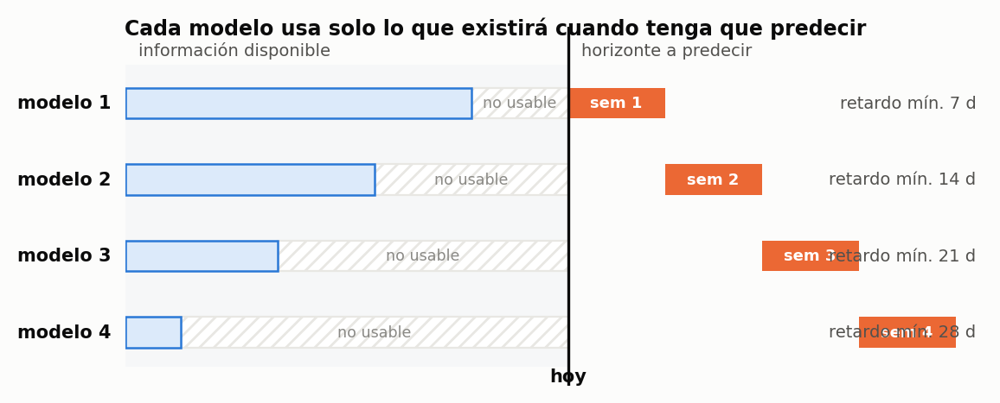
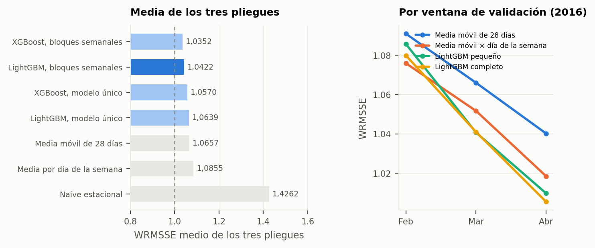
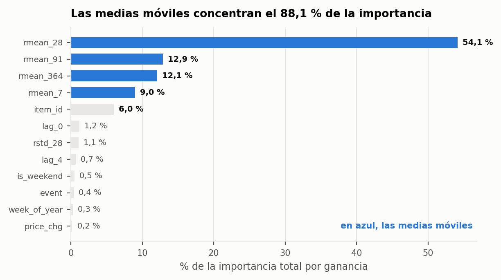
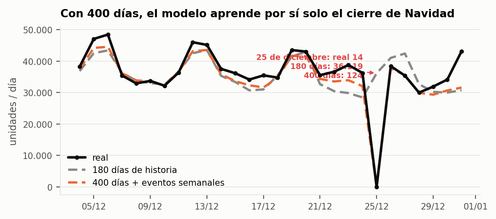
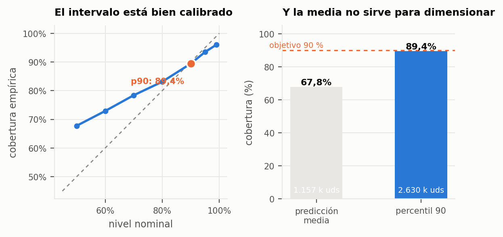
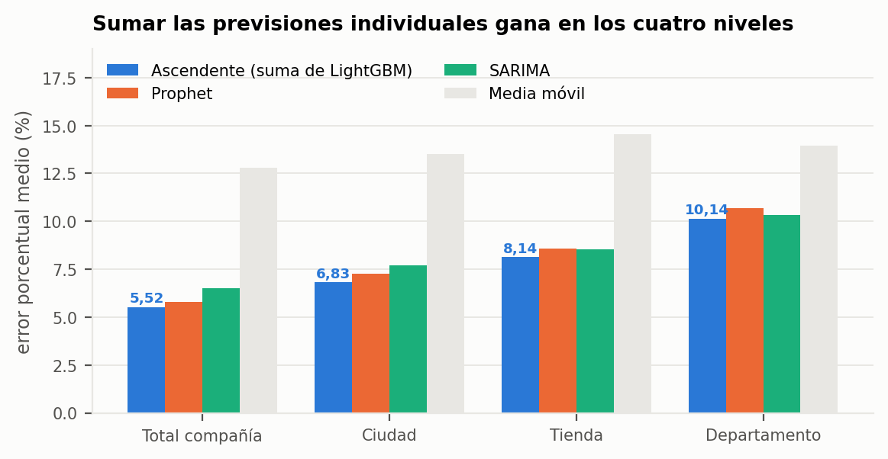
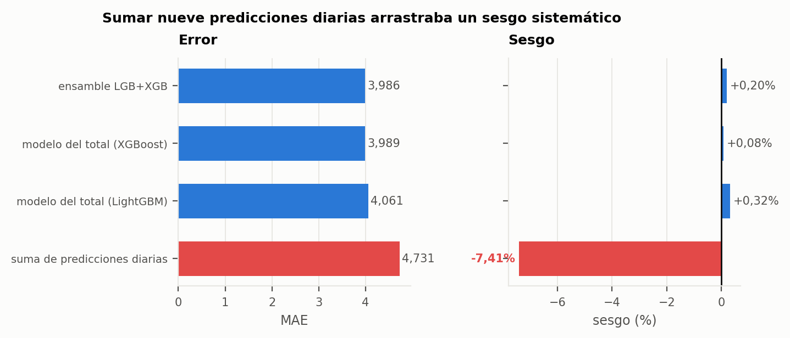

## 7.3. Cuánto vamos a vender

> «¿Sigue siendo válido sumar las predicciones individuales para obtener las de los niveles
> agregados?»
> — Paul Rogers, director financiero

Este es el capítulo más técnico del trabajo y el que exige más honestidad, porque su primer
resultado relevante es negativo: con la formulación ingenua del problema, ninguno de los modelos
ensayados supera con claridad a una media móvil.

### 7.3.1. Diseño de la comparación

Se compararon varias familias de modelos bajo el protocolo único descrito en §6.5: validación
*walk-forward* de tres pliegues (cortes en el 31 de enero, el 28 de febrero y el 27 de marzo de
2016), ventana de entrenamiento de 180 días, horizonte de 28 días y evaluación sobre las 30.490
series. La métrica de decisión es el WRMSSE, ponderado por la facturación de los últimos 28 días.

- **Referencias**: naive estacional (lo vendido cuatro semanas antes), media móvil de 28 días y
  media por día de la semana de las últimas ocho semanas.
- **Modelos globales de árboles**: LightGBM y XGBoost con objetivo Tweedie, entrenados sobre todas
  las series a la vez, con 26 variables (historia reciente, dispersión, calendario, precio e
  identidad, entre ella el grupo de producto de §7.2).
- **Modelos clásicos para el agregado**: Prophet y SARIMA(1,1,1)(1,1,1,7), que no escalan a 30.490
  series pero son la comparación natural en los niveles de agregación (§7.3.8).

La distinción entre modelos **globales** y **locales** es la decisión de diseño más importante
del capítulo. Un modelo local ajusta parámetros a una sola serie y no puede aprender nada de las
demás; con series que venden dos unidades diarias, eso significa estimar sobre muy poca señal.
Un modelo global aprende un único conjunto de parámetros sobre las 30.490 series a la vez y
comparte la información entre ellas: lo que aprende de una referencia de alta rotación sobre el
efecto del fin de semana lo aplica a una de venta escasa que por sí sola nunca lo habría mostrado.

### 7.3.2. El resultado incómodo

Con la estrategia ingenua —un solo modelo que predice los veintiocho días con información de al
menos veintiocho días de antigüedad— **LightGBM no supera a la media móvil de 28 días**: WRMSSE de
1,0639 frente a 1,0657, un empate técnico. XGBoost queda en 1,0570, un 0,8 % por debajo de la media móvil. La razón no es un mal ajuste,
sino que el modelo único debe renunciar, también en los primeros días del horizonte, a la
información más reciente de que se dispondría en explotación.

### 7.3.3. La estrategia de horizonte, que es lo que cambia el resultado

Con la **estrategia por bloques semanales** descrita en §6.4.2 —cuatro modelos cuya información
mínima tiene 7, 14, 21 y 28 días de antigüedad— la comparación se separa de las referencias:

| Modelo (media de los tres pliegues) | WRMSSE |
|---|---|
| **XGBoost, bloques semanales** | **1,0352** |
| LightGBM, bloques semanales | 1,0422 |
| XGBoost, modelo único | 1,0570 |
| LightGBM, modelo único | 1,0639 |
| Media móvil de 28 días | 1,0657 |
| Media por día de la semana | 1,0855 |
| Naive estacional | 1,4262 |

{width=100%}

El hallazgo metodológico es la magnitud relativa de los dos efectos: **la organización del horizonte
mejora un 2 % el mismo algoritmo (de 1,0639 a 1,0422 en LightGBM y de 1,0570 a 1,0352 en XGBoost), mientras que la
diferencia entre ambas bibliotecas con la misma estrategia es de 0,007 (0,7 %)**. Definir qué información puede ver el
modelo rinde unas tres veces más que elegir la biblioteca. XGBoost queda ligeramente por delante en las cuatro
métricas; se adopta LightGBM con bloques semanales porque todo el desarrollo posterior (400 días, eventos semanales,
modelo cuantílico y entrega) se construyó sobre él, y evaluar XGBoost en el modelo final queda como línea de mejora.

El resultado se matiza según la métrica. En error absoluto medio la media móvil queda al nivel de
los modelos (1,0401 frente a 1,0462 de LightGBM y 1,0349 de XGBoost), porque el MAE trata igual a todos los productos y
la mayoría son de baja rotación, donde el promedio reciente es casi imbatible. El WRMSSE pondera por
facturación y ahí los modelos ganan: aciertan más donde está el dinero. Un WRMSSE ligeramente
superior a 1 significa que, ponderando por facturación, el error a 28 días vista es comparable al
de repetir el dato del día anterior (el denominador del RMSSE, §6.6), una referencia exigente
porque conoce el día anterior y el modelo no.

{width=100%}

### 7.3.4. Qué mira el modelo y cuánta complejidad hace falta

El análisis de importancia de variables arroja un resultado que conviene no maquillar: la media
móvil de 28 días, `rmean_28`, concentra el **54,1 %** de la importancia total, y las cuatro medias
móviles juntas (7, 28, 91 y 364 días) el **88,1 %**. El identificador del producto pesa un 6,0 %, y
las variables de evento y de fin de semana no llegan al 1 % cada una. El grupo de producto de §7.2
no se incluye como variable: en el experimento con y sin él pesaba un 0,18 % de la importancia y no
mejoraba la predicción (cuaderno 03b); su papel es de interpretación, no de precisión. La lectura es que el modelo
hace, esencialmente, una media móvil refinada, y que el valor está en estimar bien el nivel reciente
de cada serie, no en modelar efectos de calendario producto a producto.

{width=100%}

Esa lectura se contrastó con una **escalera de complejidad**, de menor a mayor, evaluada en las tres
ventanas:

| WRMSSE | Feb 2016 | Mar 2016 | Abr 2016 | Media |
|---|---|---|---|---|
| Media móvil de 28 días | 1,0909 | 1,0660 | 1,0402 | 1,0657 |
| Media móvil × día de la semana | 1,0759 | 1,0517 | 1,0185 | 1,0487 |
| LightGBM pequeño (7 variables, 15 hojas) | 1,0857 | 1,0407 | 1,0098 | 1,0454 |
| LightGBM completo (180 días) | 1,0799 | 1,0410 | 1,0055 | 1,0422 |
| Modelo final (400 días + eventos) | — | — | 1,0002 | — |

El escalón más rentable es multiplicar la media móvil por un factor de día de la semana y departamento
(reduce el WRMSSE entre un 1,3 % y un 2,1 %) sin ningún aprendizaje automático. El
LightGBM pequeño queda a un 0,3 % del completo. En el período normal del año el modelo completo
aporta entre −0,4 % y 1,3 % sobre la media móvil por día de la semana; su justificación está en la
temporada alta (§7.3.5).

Una búsqueda de hiperparámetros sobre un pliegue, validada en otro que no participó en la búsqueda,
confirma la zona plana: la configuración afinada **no mejoró** el WRMSSE (0,9788 en la original
frente a 0,9790 en la afinada). No hay margen para que un modelo de mayor capacidad extraiga señal
adicional, porque el techo lo pone el ruido de una serie que vende dos unidades diarias, no la
arquitectura.

### 7.3.5. Dónde falla: la temporada alta

Las tres ventanas corresponden a febrero-abril, pero el negocio concentra su actividad en
noviembre y diciembre. Se evaluaron dos ventanas adicionales de 2015 (6 de noviembre a 3 de
diciembre y 4 a 31 de diciembre), entrenando solo con datos anteriores. Con 180 días de historia el
WRMSSE es de 1,0542 en noviembre y de **1,1090 en diciembre**, y la ventaja sobre la media móvil
(1,1161) casi desaparece. El diagnóstico por días identifica tres causas: el 25 de diciembre el
modelo predijo **35.966 unidades frente a 14 reales** (la tienda cierra), subestimó la subida de
los días 22 a 24 (−17 %, −23 % y −21 %) y subestimó el 31 de diciembre en un 28 %.

La causa es estructural: la ventana de entrenamiento de 180 días que precede a diciembre **no
contiene ninguna Navidad**, de modo que el modelo no tiene información sobre el cierre ni sobre el
desplome de demanda de ese día. Se evaluaron dos remedios:

- **Eventos a nivel semanal** (cuatro variables: si hay evento esa semana, cuál, y cuántos días
  faltan o han pasado). Con 180 días de historia no aportan nada: pesan un 0,15 % de la importancia
  y las diferencias son de unas pocas milésimas (0,004 como máximo).
- **Más historia: 400 días.** Para predecir diciembre de 2015 el modelo ya ha observado la Navidad
  de 2014.

| WRMSSE | 180 días | 400 días | 400 días + eventos semanales |
|---|---|---|---|
| Noviembre 2015 | 1,0542 | 1,0205 | **1,0156** |
| Diciembre 2015 | 1,1090 | 1,0504 | **1,0469** |
| Media febrero-abril 2016 | 1,0422 | **1,0373** | 1,0381 |

Diciembre mejora un **5,3 %** y noviembre un **3,2 %** solo por la historia (5,6 % y 3,7 % con los eventos
semanales), y el resto del año no empeora. Casi toda la mejora procede de la historia adicional; las variables
semanales añaden entre un 0,3 % y un 0,5 % en temporada alta y restan un 0,1 % en febrero-abril. Con
400 días el modelo **aprende por sí solo el cierre**: predice 161 unidades para el 25 de diciembre
de 2015 frente a 14 reales (antes, unas 36.000), la semana del 18 al 24 pasa de un error del −9,7 %
al −5,2 %, y la semana de Black Friday de +9,5 % a +0,3 %. El pico del 31 de diciembre sigue sin
captarse del todo (−27 %). La regla de cierre sobre `dim_calendario` se mantiene en la carga de
predicciones como salvaguarda, pero ya no es la que corrige el error.

{width=100%}

### 7.3.6. Intervalos de predicción

La reposición no necesita saber cuánto se venderá en promedio, sino cuánto podría venderse en el
peor caso razonable. Se entrenó por ello un segundo conjunto de modelos con **regresión
cuantílica** al percentil 90, minimizando la pérdida pinball descrita en §6.6.1.

La calibración resultó ser buena: la **cobertura empírica del percentil 90 fue del 89,4 %** frente
a un objetivo del 90 %, con una pérdida pinball de 0,3059 frente a 0,5266 si se usara la predicción
media y 0,3667 con el atajo «media móvil × 2,5». La predicción media cubre únicamente el **67,7 %**
de las observaciones, de modo que dimensionar el inventario con ella produciría rotura en una de
cada tres combinaciones producto-día.

La calibración se sometió además a una comprobación adicional. Una cobertura empírica correcta
lo es sobre la ventana en que se midió, y nada garantiza que lo siga siendo. La **predicción
conforme** convierte esa observación en una garantía de cobertura en muestra finita sin
supuestos distribucionales: se calibra el error de conformidad sobre un pliegue que el modelo no
vio y se corrige el cuantil con él. El resultado confirma la calidad del modelo original —la
cobertura pasa del **89,90 % al 90,46 %** y el intervalo se ensancha apenas 0,02 unidades— y por
clase de predictibilidad la corrección se concentra donde cabía esperarla: X 89,73→89,85,
Y 89,22→89,78, Z 90,96→91,80. Lo que se gana no es precisión sino **rigor**: un compromiso de
nivel de servicio respaldado por una garantía formal y no por una observación afortunada.

El precio de esa cobertura también se cuantificó: pasar del 68 % al 90 % de nivel de servicio exige
un **128 % más de inventario** (2.630.372 unidades frente a 1.151.452 para las mismas cuatro
semanas). La decisión de dónde situarse en esa curva no es estadística sino económica, y se
resuelve en §7.4.

{width=100%}

### 7.3.7. Calibración del sesgo

El modelo subestima de forma sistemática (un 1,8 % en la última ventana). Se examinó si un factor
multiplicativo lo corrige. Los factores necesarios en cada pliegue son **1,0733, 1,0251 y 1,0186**:
el sesgo no es una constante, cambia con el período. Calibrar con el promedio de los dos primeros
pliegues (1,0492) sobrecorrige: el sesgo del último pliegue pasa de −1,83 % a +3,00 % y el WRMSSE y
el MAE empeoran. Calibrar con el pliegue más reciente (1,0251) lo deja en +0,63 % con el WRMSSE
prácticamente intacto (1,0055 a 1,0059).

La conclusión no es la magnitud del sesgo sino su **inestabilidad**. La calibración se aplica con la
ventana de validación más reciente y se recalcula en cada reentrenamiento, nunca como un factor fijo.
Se justifica porque para reponer el signo del error importa más que su tamaño: un modelo que se
queda corto de forma sistemática genera roturas sistemáticas en los mismos productos.

### 7.3.8. La respuesta a la pregunta del director financiero

La pregunta de si los agregados pueden obtenerse sumando las previsiones individuales se
respondió de forma empírica en cuatro niveles —total de la compañía (1 serie), ciudad (3), tienda
(10) y departamento (7)— comparando el enfoque **ascendente** (*bottom-up*: suma de las
predicciones de LightGBM por bloques) con el modelado **directo** de la serie agregada con Prophet,
SARIMA y una media móvil. Error porcentual medio de las tres ventanas:

| Nivel | Ascendente | Prophet | SARIMA | Media móvil |
|---|---|---|---|---|
| Total compañía | **5,52 %** | 5,79 % | 6,50 % | 12,79 % |
| Ciudad | **6,83 %** | 7,28 % | 7,72 % | 13,50 % |
| Tienda | **8,14 %** | 8,59 % | 8,54 % | 14,55 % |
| Departamento | **10,14 %** | 10,69 % | 10,33 % | 13,95 % |

El ascendente gana en los cuatro niveles, por 0,2 a 0,5 puntos. La respuesta a Paul Rogers es que
**sumar las previsiones individuales es válido y mejora a modelar cada agregado por separado**:
basta un único modelo a nivel tienda-producto y todos los informes se obtienen sumando, sin
resolver inconsistencias entre totales. Prophet y SARIMA capturan bien la estacionalidad del
agregado, pero no pueden aprovechar la información de las 30.490 series individuales, que es de
donde procede la ventaja. El error se compensa hacia arriba: baja del 10,1 % en departamento al
5,5 % en compañía, de modo que la precisión del número que ve el comité de dirección no informa
sobre la que necesita quien repone un producto en una tienda. Todos los enfoques subestiman
(el ascendente un 1,8 %, Prophet un 1,3 %, la media móvil un 2,4 % y SARIMA un 3,8 %), el sesgo tratado en §7.3.7.

Un ejercicio complementario de reconciliación óptima (MinT) sobre los seis niveles de la jerarquía,
con una medida de error distinta, mejoró al enfoque ascendente del 15,12 % al 13,71 % y añade la
propiedad de coherencia garantizada entre niveles. No cambia la respuesta: sumar es válido, y
reconciliar es una mejora opcional.

{width=100%}

### 7.3.9. El objetivo correcto no es el día, es el ciclo

Las secciones anteriores predicen la demanda de cada día y después la política de §7.4 suma los
nueve días que cubre un pedido. Esa cadena arrastra nueve errores para producir una sola cifra, y
la cifra que la decisión necesita es únicamente el total. La pregunta que se desprende es si
conviene predecir directamente ese agregado.

Se entrenó por tanto un modelo cuyo objetivo es el **total del ciclo** en lugar de la venta
diaria, sobre los mismos datos y la misma validación:

| Enfoque | MAE | RMSE | Sesgo |
|---|---|---|---|
| Suma de nueve predicciones diarias | 4,731 | 12,255 | **−7,41%** |
| Modelo del total (LightGBM) | 4,061 | 9,666 | +0,32% |
| Modelo del total (XGBoost) | 3,989 | 9,688 | +0,08% |
| **Ensamble de ambos** | **3,986** | **9,457** | +0,20% |

{width=100%}

La mejora del error absoluto medio es del **15,7%**, pero el resultado relevante es la última
columna: el sesgo pasa de **−7,41% a +0,20%**. Sumar predicciones diarias no solo acumulaba
error, acumulaba error *en una dirección*, infravalorando sistemáticamente la demanda del ciclo
—y por tanto el pedido.

La lectura metodológica es la misma que atraviesa el capítulo: **el error no venía del modelo
sino de cómo estaba planteado el objetivo**. Agregar promedia el ruido y, sobre todo, entrena
exactamente sobre la cantidad que se usa para decidir.

### 7.3.10. Productos sin histórico

Una referencia recién incorporada al catálogo no tiene retardos ni medias móviles, es decir,
carece del 86% de la información que el modelo utiliza. Es además el momento en que un error de
dimensionamiento resulta más caro. Se evaluaron por ello cuatro formas de estimar su demanda
media, sobre un conjunto de productos ocultados por completo —en todas las tiendas— durante el
entrenamiento:

| Procedimiento | MAE | Mejora sobre la referencia |
|---|---|---|
| **Misma referencia en la tienda más parecida** | **0,918** | **34,6%** |
| Modelo por atributos (categoría, departamento, tienda, precio) | 1,028 | 26,8% |
| Media del departamento en la tienda | 1,343 | 4,3% |
| Media de la categoría en la tienda (referencia) | 1,404 | — |

El resultado interesante es que **la vía más simple gana al modelo**. Y su interés no es la
diferencia de error sino lo que valida: el parecido entre tiendas de §7.2.4 no es solo una
descripción, es un instrumento operativo — dice de qué establecimiento copiar cuando llega un
producto nuevo, y funciona mejor que un modelo entrenado con los atributos del producto. La
tienda de la que se copia es la más parecida de §7.2.4, que existe para todas las tiendas, de modo
que la vía se puede aplicar siempre que el producto ya se venda en otra tienda de la red.

Los dos procedimientos difieren en el sesgo: copiar de la tienda más parecida sobrestima
ligeramente (**+4,6%**), mientras que el modelo por atributos infravalora de forma apreciable
(**−27,2%**) y requeriría calibración antes de usarse. Un producto que no se vende en ninguna otra
tienda solo cuenta con el modelo por atributos o con la media del departamento.

### 7.3.11. Medir por semanas y modelo final

**Semana vista y máximo desglose.** El modelo predice las cuatro semanas siguientes, con un modelo
por semana, para cada una de las 30.490 series producto-tienda.

**Un ejemplo concreto.** Un producto de supermercado de Filadelfia que vende unas ocho unidades al
día tiene un error del 39 % medido día a día, porque nadie puede saber si mañana se venderán cuatro
o doce. Por semanas el error baja al 6 %: vendió 51, 53, 57 y 41 unidades y el modelo predijo 49,
54, 52 y 45. Un producto de compra ocasional de Nueva York, que no se vende la mitad de los días,
pasa de un 113 % a un 21 %.

**Una métrica que no se rompa con los ceros.** Más de la mitad de los días-producto no tienen
ventas. Se añade el **WAPE semanal**: se suman predicción y venta de cada serie por semana y se
mide qué parte de lo vendido fue error. Por semanas, los huecos sin ventas bajan del 57 % de los
días al 19 % de las semanas y el error del 76 % al 40 %. Con esta métrica el modelo de 180 días
**empata con la media móvil de 28 días** (40,3 % frente a 39,6 %): su ventaja en el WRMSSE viene del
reparto entre días de la semana y del peso de los productos que más facturan. Se utilizan las dos
métricas: el WRMSSE para comparar modelos y el WAPE semanal para explicar el error al negocio y
para la reposición. Por grupo de producto el error semanal va del 35 % (alta rotación diaria) al
68 % (venta esporádica con pico en eventos).

**Precios de las semanas futuras.** Utilizar los precios reales conocidos de las cuatro semanas a
predecir, en lugar de mantener el último, cambia solo 793 de las 30.490 series y la predicción un
0,04 %. Los ficheros de entrega mantienen el precio arrastrado para no alterar las cifras del resto
del proyecto.

**El modelo final** combina 400 días de historia y las variables de evento semanal, sin el grupo de
producto. En la última ventana de validación (28 de marzo a 24 de abril de 2016) obtiene un
WRMSSE de **1,0002** y un WAPE semanal del **37,8 %** frente al 38,5 % de
la media móvil. Su percentil 90 cubre el **89,4 %** de los días-producto, frente al 67,7 % de la
predicción media, y la media queda un 2,7 % por debajo de la demanda real. Es el modelo que genera
los ficheros de entrega (1.165.140 unidades de media y 2.640.527 de percentil 90 para el 25 de abril
al 22 de mayo de 2016) y el que usa la simulación de §7.4.

### 7.3.12. Límites reconocidos

El capítulo deja tres problemas abiertos, que se recogen en las conclusiones y en la propuesta
de trabajo futuro:

1. **Temporada alta.** Con 400 días de historia diciembre mejora un 5,3 %, pero sigue siendo el
   mes con más error: el modelo aún no capta del todo el pico del 31 de diciembre, y la política
   de reposición no se ha simulado en esos meses.
2. **Demanda errática.** En las series de clase Z y en la venta esporádica el error de
   predicción es el más alto. Los métodos específicos para demanda intermitente son la
   referencia obligada.
3. **Sesgo inestable.** La corrección con la ventana reciente es una solución práctica, no una
   explicación de por qué el sesgo se mueve.

### 7.3.13. Qué abre el capítulo siguiente

El capítulo entrega una previsión media, una previsión al percentil 90 y una garantía de
coherencia entre niveles. Nada de eso repone una sola unidad. La pregunta siguiente es qué se
hace con estos números.
