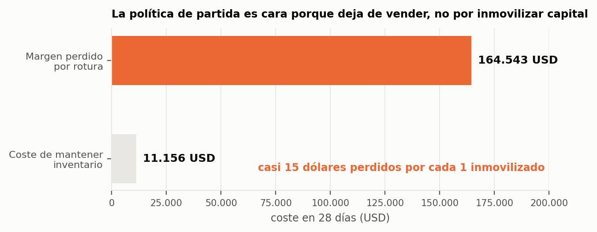
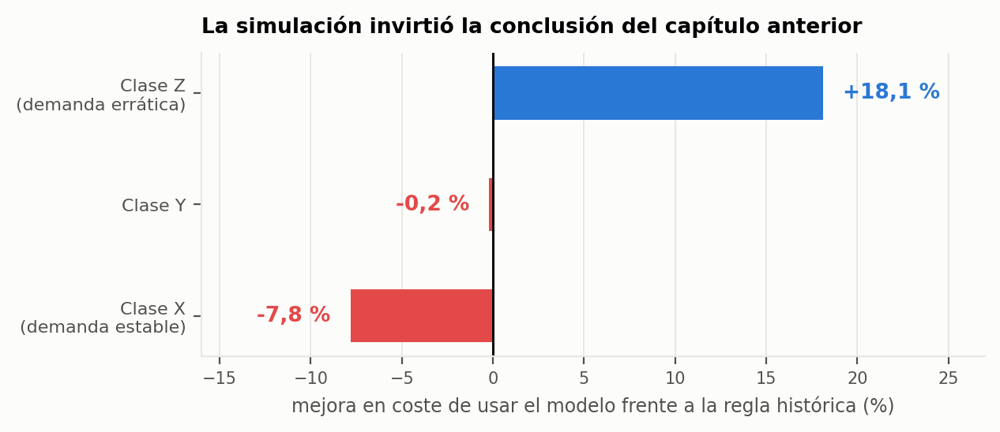
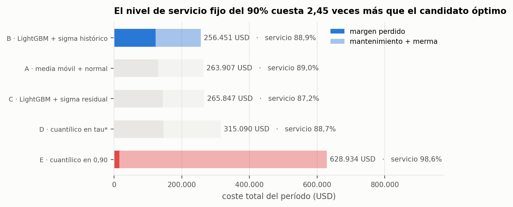
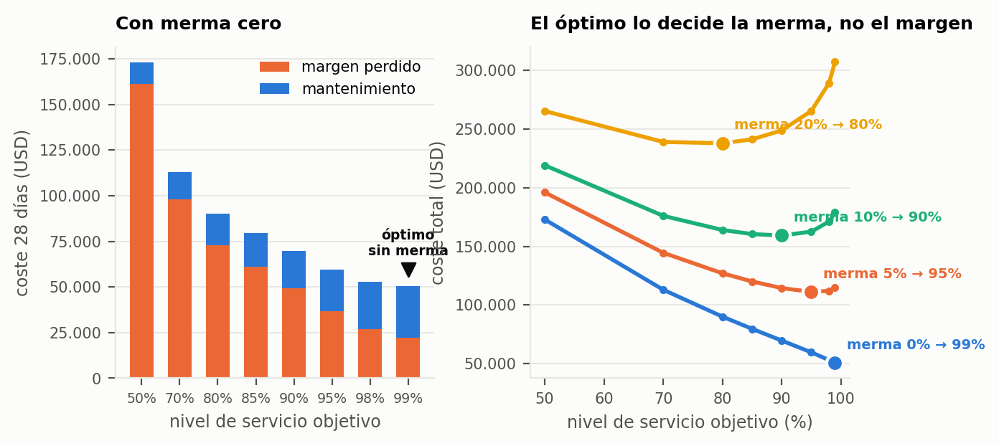
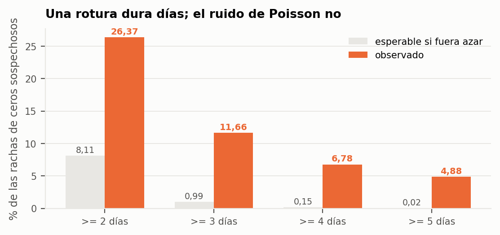

## 7.4. Cuánto hay que pedir

> Una predicción no repone nada. Alguien tiene que decidir cuántas unidades entran en el
> pedido, y esa decisión tiene un coste que la predicción no mide.

El capítulo anterior entregó números; este los convierte en unidades pedidas y, sobre todo,
cambia la unidad de medida del trabajo: se abandona el error de predicción y se pasa al dinero.

### 7.4.1. El marco: el problema del vendedor de periódicos

La decisión de cuánto pedir ante una demanda incierta es un problema clásico de la teoría de
inventarios. Ante una demanda aleatoria $D$ y una cantidad pedida $S$, el coste esperado es

$$C(S) = C_u \cdot \mathbb{E}\big[(D-S)^{+}\big] + C_o \cdot \mathbb{E}\big[(S-D)^{+}\big]$$

donde $C_u$ es el coste unitario de quedarse corto —el margen de una venta que no ocurrió— y
$C_o$ el de pasarse —mantenimiento del inventario más merma del remanente. La cantidad que
minimiza ese coste no es la demanda esperada sino un **cuantil** de la distribución de la
demanda, determinado por el **ratio crítico**:

$$\tau^{*} = \frac{C_u}{C_u + C_o}$$

Este resultado es el que estructura todo el capítulo. La decisión de reposición no necesita una
predicción de la media: necesita una predicción de un cuantil, y qué cuantil lo dice la economía
del producto, no el análisis.

La política adoptada es de **revisión periódica** con nivel objetivo: cada $R$ días se revisa el
inventario y se pide la diferencia hasta un nivel $S$ que debe cubrir la demanda de los $R + L$
días siguientes, siendo $L$ el plazo de entrega. Con $R = 7$ y $L = 2$, cada pedido cubre nueve
días.

$$S = \hat{D}_{R+L} + z_{\tau^{*}} \cdot \sigma_{R+L} \qquad
\text{pedido} = \max\big(S - \text{posición de inventario},\ 0\big)$$

### 7.4.2. Una política híbrida por segmento

La implementación no aplica el mismo método a todas las series. Para las de **clase X** —demanda
estable— el nivel objetivo se toma del percentil de las ventas históricas en ventanas de nueve días, que en esas series es fiable. Para las de **clase Y y Z** se toma directamente del modelo cuantílico de §7.3.6.

Esta separación no es una elección estética: es el resultado del experimento descrito en §7.4.4,
y llegar a ella exigió contradecir una conclusión propia del capítulo anterior.

### 7.4.3. Cuánto cuesta la política actual

La simulación se ejecutó sobre las **30.490 series durante cuatro semanas** con la demanda que
realmente se observó. El primer resultado describe el punto de partida:

| Componente del coste | Importe (28 días) |
|---|---|
| Margen perdido por rotura | **164.543 USD** |
| Coste de mantenimiento de inventario | **11.156 USD** |

La proporción es lo relevante: **casi quince dólares de venta perdida por cada dólar de inventario
inmovilizado**. La política de partida no es cara porque acumule existencias; es cara porque
deja de vender. Ese diagnóstico, que la métrica de error no puede dar, orienta toda la
optimización posterior en una única dirección: subir el nivel de servicio.

{width=100%}

Aplicando la política híbrida con un objetivo del 90%, el nivel de servicio pasa del **86,6% al
96,2%** y el coste total desciende un **62,5%**, de 175.699 a 65.856 dólares. La híbrida mejora
también a las dos alternativas puras —solo histórico (70.414 USD) y solo modelo (67.595 USD)— con
cualquier objetivo entre el 85% y el 98%.

Las predicciones que alimentan la simulación son las del modelo final de §7.3 (400 días de
historia y eventos semanales) sobre la última ventana de validación, del 28 de marzo al 24 de
abril de 2016.

### 7.4.4. La simulación refuta la conclusión del capítulo anterior

En §7.3 el grupo de producto con menor error de predicción era Alta rotación diaria
(WAPE semanal del 35 %) y uno de los de mayor error, Venta esporádica con pico en eventos (68 %). Leído así,
el modelo debería usarse en el primero y no en el segundo. La simulación de la política dice lo
contrario:

| Segmento | Efecto de usar el modelo frente a la regla histórica |
|---|---|
| Clase Z (demanda errática) | **+18,1%** de mejora en coste |
| Venta esporádica con pico en eventos | **+26,2%** |
| Clase Y | −0,2% (empate) |
| Clase X (demanda estable) | **−7,8%**: el modelo empeora el resultado |
| Alta rotación diaria | **−7,2%** |

La única excepción relevante es Pico de diciembre (−49,9%), que en una ventana de marzo-abril
está fuera de temporada y pesa poco en dinero (unos 800 de 67.600 dólares); necesita una regla de
temporada propia.

La explicación es que en las series estables el percentil histórico es un estimador excelente de la
incertidumbre —hay muchos datos y poca varianza— mientras que el modelo cuantílico introduce
ruido de estimación sin aportar información nueva. En la demanda errática ocurre lo contrario: el
histórico es escaso y errático, y el modelo, que aprende de las 30.490 series a la vez, aporta
la estructura que la serie individual no tiene.

{width=100%}

Este es el segundo de los cuatro momentos en que una prueba refutó una conclusión del trabajo.
Elegir la política por el RMSSE habría llevado a la decisión opuesta en ambos extremos.

### 7.4.5. La función de pérdida correcta

El hallazgo anterior admite una lectura más general, que el trabajo formula de forma explícita
porque es su aportación metodológica más transferible.

El WRMSSE con el que se eligió el modelo en §7.3 es una métrica **simétrica**: penaliza igual
pasarse que quedarse corto. La empresa no paga igual. Y la métrica que sí describe lo que la
empresa paga —el coste del vendedor de periódicos— resulta ser, salvo una constante
multiplicativa, la **pérdida pinball evaluada en el ratio crítico**:

$$C(S) = (C_u + C_o) \cdot L_{\tau^{*}}(D - S)$$

De esta identidad se siguen tres consecuencias.

**Primera**, elegir el modelo por su coste de negocio no supone renunciar al rigor estadístico:
la métrica de negocio tiene un equivalente estadístico exacto. Es la misma función de pérdida,
evaluada en el cuantil que determina la economía del producto en lugar de en uno elegido por
convención.

**Segunda**, el nivel de servicio del 90% que el trabajo emplea como referencia es un valor
fijado a mano. El ratio crítico indica cuál debería ser: con un margen del 25% y un coste de
posesión del 5%, $\tau^{*} \approx 0{,}83$; con un producto perecedero de merma del 20%,
$\tau^{*} \approx 0{,}50$. La distancia respecto del 0,90 uniforme es considerable, y la
consecuencia es que hoy el sistema pide de más en unos productos y de menos en otros.

**Tercera**, si la función de pérdida cambia, el modelo ganador puede cambiar. Esta última
afirmación se sometió a prueba de forma directa: se compararon cinco candidatos sobre el mismo
período, ordenándolos por error estadístico y por coste simulado de la política que se deriva de
cada uno.

| Candidato | WRMSSE | Coste (USD) | Nivel de servicio |
|---|---|---|---|
| **B · LightGBM + desviación histórica** | **0,837** | **256.451** | 88,9% |
| A · media móvil + normal | 0,867 | 263.907 | 89,0% |
| C · LightGBM + desviación de residuos | 0,837 | 265.847 | 87,2% |
| D · cuantílico entrenado en $\tau^{*}$ | 0,916 | 315.090 | 88,7% |
| E · cuantílico en 0,90 fijo | 1,395 | **628.935** | 98,6% |

**Los dos criterios coinciden en el ganador.** Es un resultado tranquilizador y merece
enunciarse como tal: en este problema la métrica estadística resulta un buen sustituto de la
económica, y elegir por WRMSSE no habría costado dinero. La hipótesis que motivó el experimento
no se confirmó.

Pero el experimento reveló otra cosa, y de magnitud muy superior. **La fila E es la política que
el trabajo venía aplicando**, con nivel de servicio fijado en 0,90 para todos los segmentos, y
resulta ser **2,45 veces más cara** que la mejor alternativa. Compra 9,7 puntos de nivel de
servicio a un coste de 372.000 dólares en cuatro semanas. Con margen del 25%, coste de posesión del 5% y merma del 5%, el ratio crítico es **0,714**, no 0,90.

Es decir: la pregunta por la función de pérdida no cambió el modelo, cambió **el nivel de
servicio**, y ahí estaba el error caro. Un parámetro fijado por convención y nunca sometido a
comprobación resultó ser la decisión más costosa del sistema.

{width=100%}

*Nota:* este experimento, como el resto de los de la carpeta `avanzado/`, se ejecutó con la
configuración anterior del modelo (180 días de historia); sus conclusiones son comparativas entre
candidatos y no dependen de esa configuración.

Dos observaciones adicionales de la misma tabla. La primera, que el candidato B gana en ocho de
los nueve segmentos ABC/XYZ, pero **en CZ gana la media móvil simple**: en la demanda más
errática el modelo no aporta. La segunda, que sobre una rejilla de doce combinaciones de margen
y merma el candidato B gana en once, y solo cede con margen del 10% y merma del 20%. El ganador
es **robusto a los supuestos**, que era exactamente lo que había que comprobar antes de
recomendarlo.

Esa comprobación no es un adorno: el coste depende de parámetros que DSMarket no ha facilitado
—margen por categoría, coste de posesión, merma—, de modo que cualquier ranking basado en él es
condicional. Presentar un ganador sin la rejilla de sensibilidad sería presentar un número sin
intervalo.

### 7.4.6. La curva de servicio y quién decide el óptimo

Se calculó el coste total para ocho niveles de servicio objetivo entre el 50% y el 99%,
descompuesto en margen perdido, mantenimiento y merma. El resultado más útil para la dirección
no es el óptimo sino de qué depende:

| Supuesto de merma sobre el remanente | Nivel de servicio óptimo |
|---|---|
| 0% | 99% |
| 10% | 90% |
| 20% | 80% |

Y el contraste que da sentido a la tabla: **mover el margen bruto entre el 10% y el 35% deja el
óptimo en el rango 98–99%**. Es decir, el nivel de servicio óptimo lo decide la merma, no el
margen. La recomendación operativa que se deriva no es un número de nivel de servicio sino una
instrucción de medición: DSMarket necesita medir su tasa de merma por categoría, porque es el
parámetro del que depende la política y es el único que hoy no conoce.

Mientras tanto, la política propuesta fija el nivel por categoría con la propia curva como guía:
**90% para SUPERMARKET**, que incluye los frescos (óptimo con una merma en torno al 10%), y **95%
para ACCESORIES y HOME_&_GARDEN**, cuyo sobrante se vende la semana siguiente (óptimo con una
merma en torno al 5%). Son valores provisionales: el código los lee de una única tabla, de modo
que medir la merma real basta para ajustarlos. Con la política híbrida, un objetivo del 95% da un
servicio real del 97,3% y un coste de 55.701 dólares en las cuatro semanas.

{width=100%}

Se documenta también el coste del servicio en términos de inventario: pasar de una cobertura del
68% —la que da la predicción media— al 90% exige un **127% más de stock**. La curva es
fuertemente convexa en su tramo alto, lo que significa que los últimos puntos de servicio son
desproporcionadamente caros.

### 7.4.7. Cuánta demanda no estamos viendo

Las cifras anteriores se apoyan en la demanda observada, que por la razón expuesta en §6.2.4 no
es la demanda real. Este apartado acota la diferencia.

**El procedimiento.** Un cero puede corresponder a ausencia de demanda —lo habitual en la cola
larga— o a ausencia de producto. Los dos casos se separan por verosimilitud: bajo un modelo de
Poisson con la intensidad esperada del día, obtenida de la media móvil de 28 días corregida por
el perfil de día de la semana, la probabilidad de observar un cero es conocida. Un cero cuya
probabilidad es inferior al 5% es incompatible con demanda nula y se marca como sospechoso.

**La comprobación que valida el procedimiento.** Un cero sospechoso aislado puede ser ruido; una
rotura de stock dura varios días. Se comparó por tanto la distribución observada de longitudes de
racha de ceros sospechosos con la que produciría el mismo número de ceros distribuidos de forma
independiente:

| Longitud de la racha | Observado | Esperable por azar | Exceso |
|---|---|---|---|
| ≥ 2 días | 26,37% | 8,11% | +18,3 pp |
| ≥ 3 días | 11,66% | 0,99% | +10,7 pp |
| ≥ 4 días | 6,78% | 0,15% | +6,6 pp |
| ≥ 5 días | 4,88% | 0,02% | +4,9 pp |

Las rachas de tres días o más resultan **doce veces más frecuentes** de lo que produciría la
distribución independiente. La firma es inequívoca: estos ceros no son demanda nula.

{width=100%}

**Las cotas.** Se construyen dos. La inferior contabiliza únicamente los ceros sospechosos,
imputándoles como demanda perdida su intensidad esperada. La superior contabiliza todos los ceros
ponderados por la probabilidad de que no fueran demanda nula. Sobre el histórico completo, la
demanda no observada se sitúa entre **3,11 y 9,64 millones de unidades**, es decir entre el
**4,79% y el 14,83%** de todo lo vendido en cinco años.

Un matiz que contradice la intuición y conviene destacar: **la censura no se concentra en la cola
larga**. La fracción oculta es notablemente uniforme entre segmentos —del 4,1% en CZ al 6,7% en
BX— y en volumen absoluto la mayor masa corresponde a **AX, con 1,70 millones de unidades
ocultas**. La rotura no es un problema de referencias marginales: afecta sobre todo a los
productos que más venden, que son también aquellos en los que cada unidad no vendida cuesta más.

De los 27,7 millones de ceros, **538.771 resultan sospechosos** —el 1,9%—, y su longitud media de
racha es de 1,71 días frente a los 1,09 que produciría la distribución independiente.

**Qué le hace esto a la cifra del capítulo.** Sobre las mismas cuatro semanas que simula §7.4.3,
la censura oculta entre **22.325 y 174.024 dólares** de margen adicional. El coste de mantenimiento
no cambia, de modo que:

| | Margen perdido | Mantenimiento | Proporción |
|---|---|---|---|
| Medido en la simulación | 164.543 USD | 11.156 USD | 15 : 1 |
| Con la cota inferior de censura | 186.868 USD | 11.156 USD | **17 : 1** |
| Con la cota superior de censura | 338.567 USD | 11.156 USD | **30 : 1** |

La proporción de quince a uno entre venta perdida y capital inmovilizado es, por tanto, un
mínimo, y en el peor escenario la asimetría se duplica. El diagnóstico del capítulo —que la
política no es cara por inmovilizar capital sino por dejar de vender— no solo se sostiene: se
refuerza.

Este resultado no debilita la conclusión del capítulo, la refuerza. Y su lectura para la compañía
es directa: después de medir la merma por categoría, la incorporación más valiosa al registro de
datos es **el inventario diario por tienda y referencia**, porque es el único dato que convertiría
estas cotas en una medición.

### 7.4.8. Qué abre el capítulo siguiente

La política de reposición toma la demanda como dada y decide cuánto pedir. Queda por examinar la
otra palanca que la compañía tiene sobre la demanda misma: el precio.
