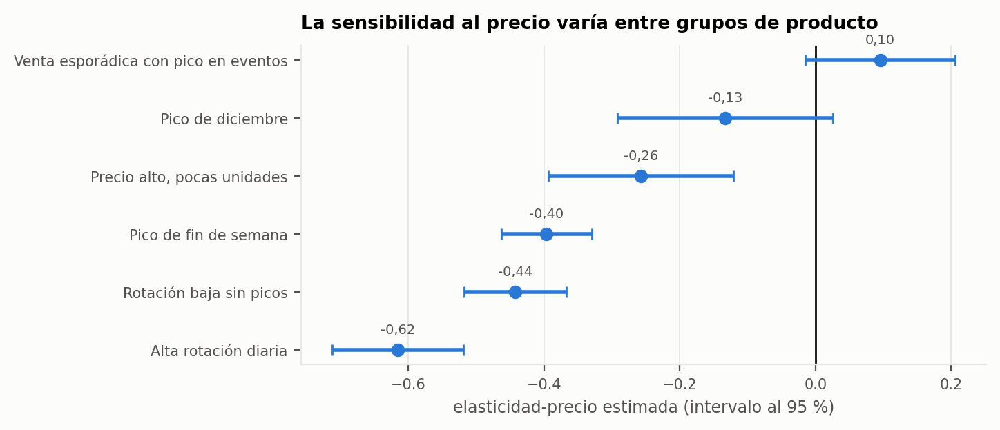
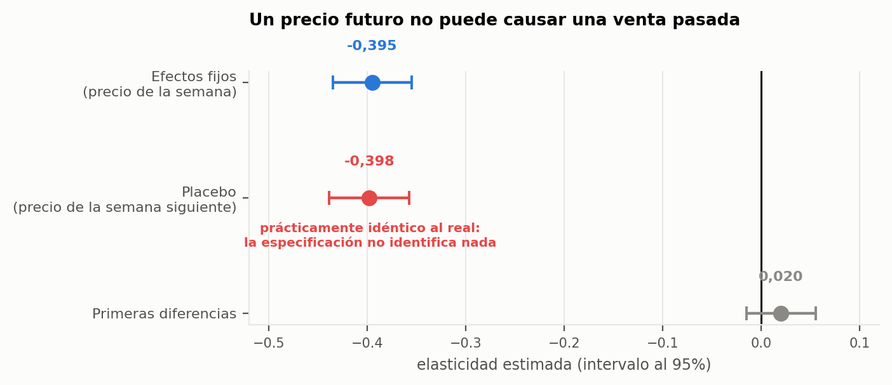
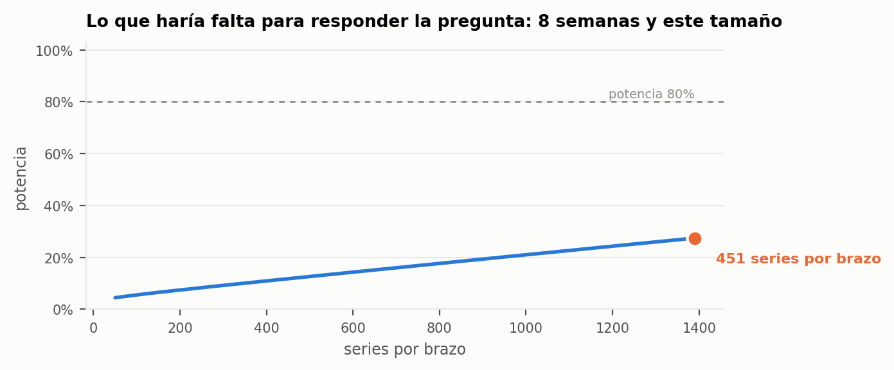

## 7.5. ¿Se puede mover el precio?

> «Nuestras acciones de marketing tendrían que explotar esas diferencias de precio entre
> tiendas.»
> — Michelle Huggins, directora de datos

El análisis exploratorio (§7.1.4) dejó establecido que el precio de una misma referencia varía
entre establecimientos. La pregunta natural es cuánto responde la demanda a ese movimiento, es
decir, cuál es la elasticidad precio. Este es el capítulo más corto del trabajo y probablemente
el más valioso, porque su respuesta es que **con estos datos la pregunta no se puede
responder**, y esa conclusión se sostiene sobre una prueba y no sobre una impresión.

### 7.5.1. La especificación

Se estimó la especificación habitual en la literatura de paneles: un modelo logarítmico doble
con efectos fijos de serie y de tiempo,

$$\log(q_{ist}) = \beta \log(p_{ist}) + \alpha_{is} + \gamma_t + \varepsilon_{ist}$$

donde $q$ son las unidades vendidas, $p$ el precio, $\alpha_{is}$ un efecto fijo por serie
producto-tienda y $\gamma_t$ un efecto fijo temporal. El coeficiente $\beta$ se interpreta
directamente como elasticidad.

Los efectos fijos de serie absorben todo lo que distingue de forma constante a una referencia en
una tienda —su nicho, su clientela, su posición en el lineal— y los efectos temporales absorben
lo que afecta a todas las series a la vez —estacionalidad, tendencia, eventos. El panel supera
los seis millones de observaciones, lo que hace inviable construir la matriz de variables
ficticias de forma explícita; la estimación se resolvió mediante **proyecciones alternadas**,
que es la implementación práctica del teorema de Frisch-Waugh-Lovell: en lugar de estimar los
efectos fijos, se elimina su influencia restando iterativamente las medias por grupo de cada
variable, y se estima $\beta$ sobre los residuos.

### 7.5.2. Un resultado excelente

La estimación arroja una elasticidad de **−0,395** con un estadístico $t$ de **−19,3**. El signo
es el correcto, la magnitud es plausible para bienes de gran consumo, la significación
estadística es abrumadora y la descomposición por grupo de producto de §7.2 tiene sentido: la
alta rotación diaria, barata y de compra frecuente, es la más sensible (−0,62); el grupo de
precio alto y pocas unidades, de los menos (−0,26); y la venta esporádica con pico en eventos y el pico de diciembre, que
se compran por la fecha, no reaccionan.

Es exactamente el tipo de resultado que una memoria presentaría como hallazgo principal y sobre
el que construiría una recomendación de política de precios.

{width=100%}

### 7.5.3. La prueba que lo derriba

Antes de escribirlo así, se aplicó una **prueba de falsación** de diseño elemental: se sustituyó
el precio de la semana en curso por el de la **semana siguiente** y se reestimó el mismo modelo.
Un precio futuro no puede causar una venta pasada. Si la especificación estuviera identificando
un efecto causal, ese coeficiente debería ser aproximadamente cero.

El coeficiente placebo resultó ser **−0,398**: prácticamente idéntico al original.

La conclusión es inmediata y no admite matices: la especificación no está midiendo la respuesta
de la demanda al precio, sino la asociación entre ambas variables generada por un tercer factor
que las mueve a la vez. La causa más plausible es la política comercial de la compañía —los
precios se fijan en función de la demanda esperada, no al azar—, lo que constituye un problema de
endogeneidad de manual.

{width=100%}

Como comprobación adicional se estimó el modelo en **primeras diferencias**, que elimina
cualquier componente de nivel persistente. La elasticidad estimada pasa a **+0,02**: el efecto
desaparece por completo.

### 7.5.4. Por qué ocurre: el precio casi no se mueve

El diagnóstico se completa con un dato descriptivo que explica la fragilidad de la estimación.
**Solo el 1,1% de las semanas presenta un cambio de precio** en una serie dada. La variación
disponible para identificar el efecto es escasísima, y además no es aleatoria: cuando el precio
se mueve, lo hace por una razón comercial que probablemente coincide con un movimiento esperado
de la demanda.

Con tan poca variación y con esa variación correlacionada con lo que se quiere medir, ningún
método observacional sobre estos datos puede separar el efecto del precio de las razones por las
que el precio cambió.

### 7.5.5. Lo que sí respondería la pregunta

La conclusión negativa se acompaña del diseño que permitiría obtener la respuesta, porque una
memoria que dice «no se puede» sin decir «así sí» deja el encargo a medias.

Se propone un **experimento de precios** con asignación aleatoria: seleccionar un conjunto de
series comparables, asignarlas al azar a un brazo de tratamiento —con una variación de precio
predefinida— y a un brazo de control, y medir la diferencia de demanda durante el período. La
aleatorización rompe por construcción la correlación entre el precio y las razones que lo
mueven, que es exactamente el problema que impide identificar el efecto con datos históricos.

El cálculo de potencia, realizado sobre la variabilidad observada en el propio panel, determina
el tamaño necesario: **451 series por brazo durante ocho semanas** para detectar una elasticidad
de −0,5 con una potencia del 80% y un nivel de significación del 5%. Es un experimento
perfectamente asumible para una cadena de diez tiendas.

Dos precisiones sobre el diseño. La primera: el precio se cambiaría por tienda, y las series de
una misma tienda comparten clientes, días y clima, de modo que no son independientes. La muestra
efectiva se acerca más al número de tiendas que al de series, y el análisis debe usar errores
agrupados por tienda; las 451 series son, por tanto, un mínimo. La segunda: para reducir la
varianza, cada tienda tratada se empareja con la tienda que más se le parece (§7.2.4) y no con
otra de su ciudad, porque el parecido entre tiendas no respeta las fronteras de ciudad.

{width=100%}

### 7.5.6. El valor de un resultado negativo

Este capítulo no aporta una elasticidad; aporta la razón por la que no se puede aportar y el
procedimiento para conseguirla. En términos de la compañía, el valor es directo: sin la prueba
de falsación, el trabajo habría entregado una recomendación de precios apoyada en una
correlación espuria, y una recomendación así aplicada a una cadena real tiene un coste que no es
académico.

Es el tercero de los tres momentos en que una prueba refutó una conclusión propia del trabajo.

### 7.5.7. Qué abre el capítulo siguiente

Los cinco capítulos anteriores producen resultados. El siguiente responde a una pregunta
distinta: qué hace falta para que esos resultados sigan existiendo dentro de seis meses.
