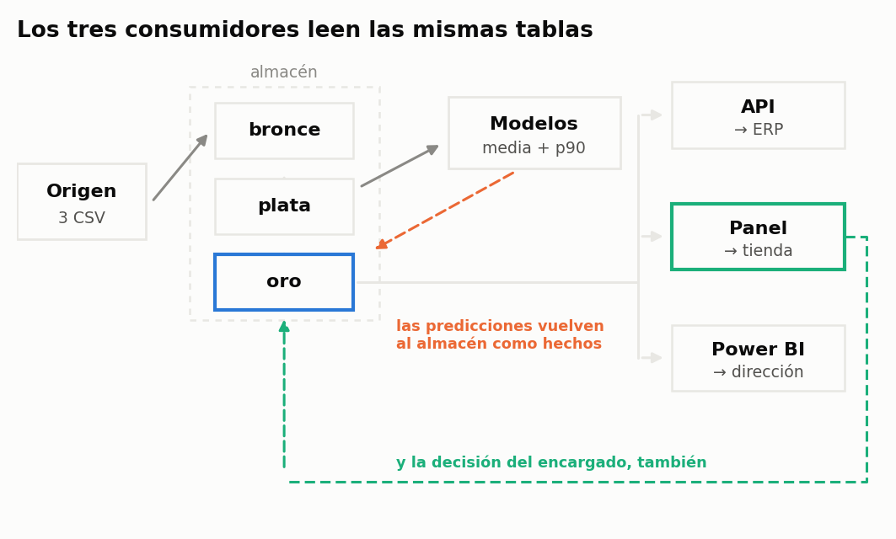
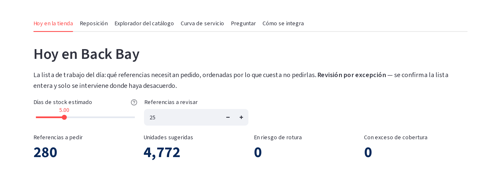

## 7.6. Cómo se sostiene esto en el tiempo

> «Migrar todas las fuentes y procesos de datos a la nube.»
> — plan estratégico a cinco años de DSMarket

Los cinco capítulos anteriores describen análisis. Este describe el sistema que permite volver a
ejecutarlos, y responde al contexto que el propio encargo plantea: DSMarket no pide un informe,
pide capacidad analítica sostenible.

### 7.6.1. El problema que resuelve

Los primeros cuadernos leían directamente los ficheros de origen. Ese esquema funciona con un
consumidor y se rompe con dos: en cuanto el cuaderno de reposición, el cuadro de mando y el
servicio web necesitan las mismas cifras, cada uno acaba con su propia lectura, su propia
limpieza y su propia interpretación de las columnas. La divergencia no aparece de golpe;
aparece meses después, cuando dos informes dan números distintos y nadie sabe cuál es el bueno.

La solución adoptada —el almacén analítico descrito en §6.3— convierte cuatro cuadernos
independientes en un sistema con una única fuente de verdad.

### 7.6.2. Lo que se construyó

**El almacén.** Tres capas —bronce, plata y oro— reconstruibles íntegramente desde los ficheros
de origen con un solo comando y en aproximadamente veinte segundos. La conversión a formato
columnar reduce los 490,9 MB de partida a 22,1 MB en la capa de bronce, y el despliegue de las
1.913 columnas diarias a formato largo produce 58.327.370 filas en cuatro segundos.

**El bucle de realimentación.** Las predicciones no se guardan como ficheros sueltos junto al
cuaderno que las produjo: se cargan en el almacén como una tabla de hechos más,
`fact_predicciones`, con la misma dimensionalidad que las ventas. Lo mismo ocurre con las
sugerencias de reposición. Esto es lo que convierte el almacén en un sistema y no en un
repositorio: la salida de los modelos vuelve a la misma estructura de la que salieron sus
entradas, y cualquier consumidor puede cruzar previsión y realidad con una unión trivial.

**El servicio de reposición.** Una interfaz de programación que responde la pregunta operativa
—cuántas unidades pedir de un producto en una tienda, dado el stock actual— aplicando la misma
política del capítulo §7.4. Carga las tablas de la capa de oro en memoria al arrancar y expone
cuatro operaciones. Dispone de trece comprobaciones automáticas que verifican tanto los casos normales
como los límite.

**El panel interactivo.** Una aplicación que expone la misma política en una pantalla, pensada
para la demostración en vivo y para el uso por parte del equipo comercial. Contiene además una
capa de lenguaje natural que traduce preguntas de negocio a consultas SQL.

**El cuadro de mando.** La especificación completa del modelo de datos, las medidas y la
disposición de páginas para su construcción en Power BI, apoyada en las tablas agregadas de la
capa de oro.

Los tres consumidores —servicio, panel y cuadro de mando— leen exactamente las mismas tablas.
No pueden discrepar, y esa propiedad es verificable.

{width=100%}

### 7.6.3. La capa de lenguaje natural y su regla de diseño

La incorporación de un modelo de lenguaje a un sistema que decide compras exige una regla
explícita, y el trabajo la formula así: **el modelo de lenguaje nunca calcula**. Recibe cifras ya
calculadas y las redacta, o traduce una pregunta a SQL que ejecuta después el motor de la base
de datos. La aritmética no la hace nunca el modelo.

La regla se materializa en tres barreras. La primera, el contexto que recibe el redactor lleva
los números ya resueltos y le prohíbe explícitamente operar con ellos. La segunda, el
componente de consulta genera SQL y no respuestas, de modo que toda agregación la realiza el
motor. La tercera, el SQL generado atraviesa un validador que admite únicamente sentencias de
lectura sobre las nueve vistas conocidas, rechaza sentencias múltiples y añade un límite de
filas si no lo trae; además se muestra siempre al usuario antes de ejecutarse.

La justificación no es tecnológica sino de responsabilidad: un sistema que sugiere pedidos de
mercadería no puede permitirse una cifra inventada, y la única garantía sólida contra eso es que
el modelo no tenga la posibilidad de producirla.

{width=100%}

### 7.6.4. Las trampas encontradas

Se documentan aquí tres errores de implementación que se detectaron durante el trabajo, porque
son silenciosos —no producen excepción, producen cifras equivocadas— y porque su documentación
es parte del valor de ingeniería del proyecto.

**La trampa del abanico.** Unir directamente la tabla de ventas, de grano diario, con la de
reposición, de grano semanal, multiplica por siete las métricas del lado semanal. El síntoma fue
un stock de seguridad agregado de 2,6 millones de unidades donde el valor correcto rondaba las
29.000. El patrón correcto —agregar cada tabla por separado y unir después— quedó documentado
como obligatorio en la guía del cuadro de mando.

**El cruce de cuantiles.** El contrato que exige que la predicción del percentil 90 no quede por
debajo de la predicción media detectó **25.296 filas de 853.720, un 2,96%**, en las que sí lo
estaba. Es imposible por definición, y su causa es que los dos modelos se entrenan por separado
—uno con pérdida Tweedie y otro con pérdida pinball— sin que nada garantice la monotonía entre
ellos; en series de demanda casi nula la media de Tweedie puede superar el cuantil estimado.

Lo relevante no es la magnitud sino dónde se concentra. La política de reposición obtiene el
stock de seguridad de la diferencia entre ambos valores, recortada a cero cuando resulta
negativa, de modo que cada fila cruzada deja a esa serie **sin stock de seguridad**. Y la
incidencia por segmento es la siguiente:

| Segmento | Predicciones cruzadas |
|---|---|
| CZ | 10,90% |
| BZ | 0,78% |
| AZ | 0,38% |
| AX | 0,00% |

El problema afecta casi en exclusiva a la clase Z, la de demanda errática: precisamente las
series que más necesitan un colchón eran las que se quedaban sin él. El hueco medio es de 0,044
unidades y el máximo de 6,77, de modo que el efecto sobre cada predicción individual es pequeño;
la magnitud relevante es otra. Contando cuántas series arrastran al menos un día cruzado dentro
del ciclo de nueve días que dimensiona el pedido, resultan **1.899 series afectadas, el 22% de la
celda CZ**. En una de cada cinco series de demanda errática el stock de seguridad quedaba
infravalorado.

La corrección tiene dos partes: imponer la monotonía en el momento de escribir las predicciones,
que es donde debe estar, y reparar el fichero ya generado. Merece mención aquí porque es el
ejemplo más claro de por qué los contratos de datos se ejecutan también **después** de generar
las predicciones y no solo sobre los datos de entrada: este defecto no está en el origen, lo
produce el propio sistema.

**El fin de semana corrido dos días.** La columna `es_fin_de_semana` de la dimensión temporal
se calculaba como `weekday_int IN (5, 6)`, que es la fórmula correcta si el índice del día
empieza en cero el lunes. En este conjunto de datos no empieza ahí: la columna de origen numera
**1 = sábado … 7 = viernes**. El resultado es que la bandera marcaba como fin de semana el
**miércoles y el jueves**, en 1.094 de los 1.913 días del histórico.

El defecto es representativo de una clase entera, y por eso se documenta. No produce excepción
ni valores imposibles: la columna es booleana y siempre tiene un valor plausible. No lo detecta
ninguna comprobación de tipos, ni de nulos, ni de rangos. Y `is_weekend` es **una de las
variables de entrada del modelo**, de modo que el efecto no se queda en un gráfico descriptivo.

Su forma peligrosa es la segunda mitad del hallazgo. Los días futuros de la dimensión, que no
existen en el fichero de origen, se rellenaban con una expresión distinta —`dayofweek(fecha) IN
(0, 6)`, esta vez correcta—, de modo que la bandera significaba **una cosa en los días con los
que se entrena y otra en los días que se predicen**. Es un desajuste entre entrenamiento y
servicio en su forma más pura: sin error, sin alerta, y permanente.

La corrección deriva la bandera del **nombre** del día en lugar del índice, que es lo único que
no depende de una convención, y usa la misma definición para el histórico y para el horizonte.
Se añadieron además dos contratos bloqueantes —uno por cada mitad del defecto— y sus dos pruebas
de regresión. El efecto colateral fue confirmar la segmentación del catálogo: con la bandera
corregida, el grupo «Fin de semana/hogar» pasa a encabezar la elevación de fin de semana con
un ×1,42, cifra que antes quedaba invisible y que es la que justifica su nombre (§7.2.3).

**La ventana predicha, corrida un horizonte entero.** El contrato que exige que toda predicción
se apoye en una fila de la dimensión temporal falló sobre las 853.720 filas de
`fact_predicciones`, es decir sobre todas. El último día con venta es el 24 de abril de 2016 y
la dimensión llega, correctamente, veintiocho días más allá, al 22 de mayo. Las predicciones
cubrían del **23 de mayo al 19 de junio**: los días 29 a 56, no los 28 primeros.

La causa es que el cuaderno tomaba como origen el final de la dimensión temporal —que ya
incluye el horizonte— en lugar del último día con venta. El resultado es un pronóstico
perfectamente válido para las cuatro semanas equivocadas, y con él unos niveles de reposición
igualmente corridos. La etapa `predecir.py` de la capa de operación ancla el horizonte en el
último día observado y no en el final del calendario, que es lo que corresponde.

Ninguno de los dos defectos se descubrió mirando los datos: los descubrieron los contratos, uno
de ellos escrito después y a propósito de una figura que no salía. Es el argumento de esta
sección entera.

**La dimensión temporal incompleta.** La tabla de calendario terminaba en el último día con
venta, de modo que las predicciones a veintiocho días no tenían fila de dimensión donde
apoyarse. Se extendió con los días futuros y una bandera que los distingue.

**La conversión de tipos en el entrenamiento.** La construcción del conjunto de entrenamiento a
partir de un `DataFrame` provoca en la biblioteca de aprendizaje una conversión interna a doble
precisión que duplica la memoria y agota la disponible. La conversión explícita previa a
precisión simple resuelve el problema.

### 7.6.5. La capa de operación

Un sistema no se distingue de un conjunto de cuadernos por los modelos que contiene sino por lo
que sabe de sí mismo. Se incorporaron por ello cuatro piezas que no producen ningún resultado
analítico y sin las cuales el trabajo seguiría siendo un prototipo.

**Orquestación.** Un único comando ejecuta las diez etapas en orden —construcción de las tres
capas, contratos, entrenamiento, puerta de promoción, predicción, reposición, contratos otra vez y monitorización—,
cronometra cada una, se detiene ante el primer fallo bloqueante y registra el resultado en una
tabla de ejecuciones. Permite además reanudar desde la etapa que falló, que es lo que convierte
un fallo en una incidencia y no en una repetición completa.

**Contratos de datos.** Quince comprobaciones que **detienen** el proceso en lugar de advertir: el
panel producto-tienda completo, ausencia de ventas sin precio, coherencia entre importe y
producto de unidades por precio, integridad referencial con las dimensiones, cobertura de la
dimensión temporal sobre el horizonte, ausencia de duplicados en el grano y no negatividad y
ordenación de los cuantiles predichos, y la coherencia de la bandera de fin de semana con el
nombre del día tanto en el histórico como en el horizonte. La distinción entre un contrato y una comprobación de
calidad está en qué ocurre cuando falla: un almacén que publica datos rotos porque la
comprobación escribió una advertencia en un registro que nadie lee es peor que uno que no
comprueba nada, porque produce una falsa sensación de control. Los contratos se ejecutan dos
veces, después de construir el almacén y antes de publicar las predicciones; la segunda pasada es
la que impide que un modelo defectuoso alcance el servicio de reposición.

**Registro de modelos.** Cada entrenamiento da de alta una fila en una dimensión de modelo con
sus hiperparámetros, la ventana de entrenamiento, la fecha de corte y las métricas de validación,
y su identificador acompaña a cada predicción producida. Permite responder la pregunta que
inevitablemente surge en explotación: con qué modelo, entrenado sobre qué datos y con qué error
de validación se calculó un pedido concreto de hace tres semanas.

**Monitorización.** Se vigilan tres cosas de naturaleza distinta. El **error realizado**, que
compara las predicciones vencidas con lo ocurrido y es la medida verdadera aunque llegue con
cuatro semanas de retraso. La **deriva de las variables de entrada**, medida con el índice de
estabilidad de población entre la ventana reciente y la de referencia, que se detecta el mismo
día sin esperar al resultado. Y la **deriva de la predicción** respecto de su propio histórico,
que detecta cambios que las entradas no revelan. Validar un modelo antes de desplegarlo no es
monitorizarlo: la validación describe el pasado, la monitorización el presente.

Las tablas de operación viven en el mismo almacén que el resto, de modo que las métricas del
sistema se consultan con el mismo SQL que los datos de negocio y el cuadro de mando puede
mostrarlas sin ninguna integración adicional.

### 7.6.6. Cómo se pondría en marcha

Un sistema que decide compras no se despliega de una vez. La ruta propuesta tiene tres fases,
cada una con su criterio de avance y su criterio de parada, y la razón de que existan es que un
error de reposición no se corrige con un despliegue nuevo: se corrige con mercadería.

**Fase 1 — Modo sombra (4 semanas).** El sistema calcula pedidos para las diez tiendas y no los
envía a nadie. Se registra la sugerencia junto a lo que el encargado pidió realmente. No hay
riesgo operativo alguno, y al final se dispone de cuatro semanas de comparación entre las dos
decisiones sobre la demanda que realmente ocurrió. *Criterio de avance:* que el sistema no sea
peor que la práctica actual en coste simulado, y que ninguna de las alertas del monitor se haya
disparado por causas ajenas a los datos.

**Fase 2 — Piloto (8 semanas, dos tiendas).** Se eligen dos establecimientos de grupos de
comportamiento distintos y se aplican las sugerencias en el segmento AX, que concentra el 56% de
la facturación y es el de demanda más estable. El resto del catálogo sigue con el procedimiento
actual, lo que proporciona un grupo de control interno. *Criterio de avance:* mejora del nivel de
servicio sin aumento del inventario medio. *Criterio de parada:* dos semanas consecutivas con el
nivel de servicio por debajo del de las tiendas de control.

**Fase 3 — Red completa, por segmentos.** Se extiende a las diez tiendas y se amplía el alcance
por celdas de la matriz ABC/XYZ, empezando por las de demanda estable y dejando para el final las
de clase Z, donde el propio trabajo documenta que la ventaja es menor y la incertidumbre mayor.
La revisión pasa a ser por excepción: el encargado confirma la lista y solo interviene donde
discrepa.

En las tres fases se registra la decisión final del encargado, que es el dato del que hoy carece
el proyecto y sin el cual ninguna de las tres puede evaluarse.

### 7.6.7. Sobre la migración a la nube

El plan estratégico de DSMarket contempla migrar sus fuentes y procesos a una plataforma en la
nube. El trabajo evaluó la posibilidad de construir directamente sobre una plataforma de ese
tipo y decidió no hacerlo, por tres razones que conviene explicitar porque la decisión podría
leerse como una limitación y no lo es.

La primera es de **volumen**: 58 millones de filas y 91 MB en la capa de consumo son un tamaño
que un motor analítico embebido procesa en segundos. La infraestructura distribuida resuelve un
problema de escala que este proyecto no tiene, y su coste de complejidad no se compensa.

La segunda es de **reproducibilidad**: un tribunal debe poder reconstruir el trabajo completo en
su propia máquina sin credenciales ni suscripciones. Un almacén basado en ficheros Parquet y un
motor embebido lo permiten; una plataforma gestionada, no.

La tercera, y la más importante, es de **portabilidad**: la arquitectura medallón, el esquema en
estrella y las transformaciones están escritas en SQL estándar sobre ficheros Parquet, que es
precisamente el formato que ingieren las plataformas de nube contemporáneas. La migración
consiste en trasladar los ficheros al almacenamiento en la nube y reapuntar el motor de
ejecución; la lógica de negocio, que es el trabajo real, no cambia.

La ruta de migración propuesta contempla tres fases: trasladar las capas de bronce y plata al
almacenamiento de objetos manteniendo el mismo formato, sustituir el motor de ejecución
conservando las mismas sentencias, y trasladar por último la orquestación. El diseño actual está
hecho para que ese camino sea posible sin reescribir el análisis.

### 7.6.8. Qué queda por hacer

Se consignan las carencias del sistema, que son conocidas y no accidentales.

El **stock actual** es el único dato que el proyecto no posee y que la decisión de reposición
necesita; hoy se introduce a mano. Su origen natural es el sistema de inventario de la compañía.

**No se registra la decisión final del encargado.** Mientras no se sepa qué se pidió realmente
frente a lo sugerido, no hay forma de medir si el sistema acierta. Es, con diferencia, la
incorporación que más valor añadiría, porque convierte el proyecto en un problema de aprendizaje
continuo en lugar de una fotografía.

**No hay autenticación ni control de acceso**, lo que es aceptable en un prototipo y no en
explotación.

**La escala del panel** está dimensionada para diez tiendas: carga el almacén en memoria al
arrancar. Con un catálogo o una red mayores haría falta consulta bajo demanda.
